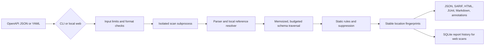

# Architecture

The project ships a CLI-only core by default. The optional `web` extra adds the local FastAPI review interface; the web worker and CLI share the same analyzer.

The analyzer never sends requests to the API described by a spec. CLI analysis sends source text to a child process over stdin; uploaded web specs are queued locally, analyzed in a child process, and then removed from the database. Report metadata and bounded source-line excerpts remain with findings so users can review the flagged line. Delete scan history to remove reports and excerpts.

## Design notes

- **Subprocess isolation:** scan work runs in a separate Python process with a hard timeout, node budget, byte limits, and bounded local reference resolution. This contains parser and traversal failures and lets the parent terminate runaway scans.
- **Memoized traversal:** shared schema references are visited once per traversal and replayed at each pointer location. Cycle guards and node/time budgets bound alias-heavy and deeply nested specifications.
- **Stable fingerprints:** finding identity uses rule ID, JSON Pointer, and a rule-specific issue discriminator. It does not depend on line numbers or source excerpts, so formatting-only edits do not churn baselines.
- **Web decision:** keep the local UI as a useful demo and review surface. Findings are grouped by rule, excerpts highlight the exact reported line, and local scan history can compare two completed reports by fingerprint.

