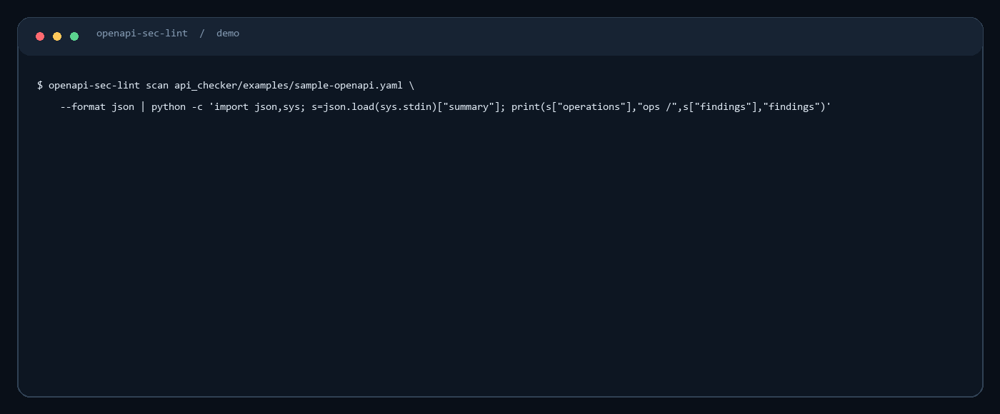

# openapi-sec-lint

**Catch security gaps in OpenAPI contracts from your terminal or CI, without probing live APIs.**

[](https://github.com/Kavin-arch/openapi-sec-lint/actions/workflows/ci.yml)
[](https://scorecard.dev/viewer/?uri=github.com/Kavin-arch/openapi-sec-lint)



## Quickstart

```sh
pip install openapi-sec-lint
openapi-sec-lint scan openapi.yaml --format sarif --output openapi-sec-lint.sarif
openapi-sec-lint scan openapi.yaml --fail-on high
```

## Choose the right linter

| Tool | Focus | Use it when |
|---|---|---|
| **openapi-sec-lint** | Security-focused, static review signals for authentication, object access, sensitive fields, SSRF, and resource limits | You want security checks with a simple CLI and a SARIF-ready GitHub Action |
| [Spectral](https://github.com/stoplightio/spectral) | Flexible rulesets for API style and description quality, with built-in OpenAPI, AsyncAPI, and Arazzo rules | You need organization-specific style guides or a general JSON/YAML ruleset engine |
| [Vacuum](https://quobix.com/vacuum/) | OpenAPI and AsyncAPI linting with recommended/custom rulesets, report formats, and change detection | You want a broad API-description linter with configurable CI reporting |

These tools cover overlapping but different needs. openapi-sec-lint findings are contract heuristics, not proof of runtime vulnerabilities; use general linting and runtime security testing where they fit.

## GitHub Security tab

The included SARIF workflow uploads a small sample report to code scanning on pushes to `main`. After its first successful run, the findings will appear in the repository's [Security tab](https://github.com/Kavin-arch/openapi-sec-lint/security/code-scanning).

A local-first CLI and optional browser UI for static review of OpenAPI 3.x and
Swagger 2.0. It never calls the described API; findings are review signals,
not confirmation of runtime vulnerabilities. The prepared
[social preview image](docs/assets/social-preview.png) is sized for GitHub.

## Checks

| Rule | Signal | Default severity |
|---|---|---|
| `AUTH-001` | Operations without an effective documented security requirement | Medium |
| `AUTH-002` | Undefined security scheme references or Basic authentication paired with HTTP | Medium |
| `AUTH-003` | OAuth flows without documented scopes or operations selecting no scopes | Medium |
| `AUTH-004` | Admin-looking operations without documented role-like scopes | Medium |
| `AUTH-005` | Discouraged OAuth implicit or password flows | Medium |
| `BOLA-001` | Integer or string object identifier parameters | Low |
| `MASS-001` | Write schemas that permit undeclared fields or omit `readOnly` on likely server-managed fields | Low |
| `TRANSPORT-001` | Declared plain HTTP servers | Medium |
| `TRANSPORT-002` | Server templates that permit HTTP or `ws://` | Medium |
| `DATA-001` | Sensitive-looking response field names | Medium |
| `RESOURCE-001` | Request arrays without `maxItems` | Medium |
| `RESOURCE-002` | Request strings/maps without bounds or top-level GET arrays without pagination | Low |
| `SSRF-001` | URL-like request fields without an enum or pattern constraint | Medium |
| `FLOW-001` | Sensitive business-flow names that merit abuse-control review | Low |
| `CONFIG-001` | Verbose 5xx schemas, wildcard request media types, or internal server URLs | Medium |
| `INV-001` | Deprecated and prerelease routes that merit inventory review | Low |
| `CONSUME-001` | Operations that appear to import or consume third-party data | Medium |
| `CONTRACT-001` | Credential-like URL parameters, missing error responses, unbounded strings, and multipart uploads | Low |

Read the [rule reference](docs/rules/README.md) for limitations and OWASP API
Top 10/CWE mappings. `MASS-001` and `RESOURCE-002` are low severity because
these contract signals are especially noisy. Use `--disable RULE-ID` to turn
off checks that do not fit your API.
All checks are static contract heuristics. `AUTH-004`, `FLOW-001`, `INV-001`,
and `CONSUME-001` use names and descriptions as review prompts; none confirms a
runtime authorization, abuse, lifecycle, or data-consumption defect.

Local JSON Pointer `$ref` references are followed. The CLI also resolves
relative file references under the directory containing the root spec; URL
references, parent-directory escapes, symlink escapes, and missing files are
rejected. Referenced files are capped at 100 files and 64 MiB combined. The web
upload accepts inline specs only because it has no local reference directory.
Findings are emitted per location and include stable fingerprints.
`x-security-ignore` records require a rule ID and review reason, with an
optional expiry date. Expired records are ignored:

```yaml
x-security-ignore:
  - rule_id: SSRF-001
    reason: "The gateway validates this destination against the allowlist."
    expires: "2027-06-30"
```

Place the extension on an operation to suppress that rule for the operation,
or on a schema property to suppress findings at that property and below it.

## Install and run

Python 3.11, 3.12, and 3.13 are supported. The default install includes the
CLI only:

```powershell
py -3.11 -m venv .venv
.\.venv\Scripts\Activate.ps1
python -m pip install openapi-sec-lint
openapi-sec-lint --help
```

To run the optional local web interface from a source checkout:

```powershell
python -m pip install -e ".[web]"
python -m uvicorn api_checker.main:app --reload
```

Open <http://127.0.0.1:8000>. The API documentation is at
<http://127.0.0.1:8000/docs>. macOS and Linux users can create a virtual
environment with `python3 -m venv .venv` and activate it with
`source .venv/bin/activate`.

The local server accepts `localhost`, `127.0.0.1`, and `::1` Host headers by
default. Set `API_CHECKER_ALLOWED_HOSTS` to a comma-separated allowlist if you
use a different local hostname. The app has no user accounts or authentication;
keep it bound to loopback unless you add deployment-specific access controls.

Scans run in an isolated subprocess with a 70-second hard timeout by default.
Set `API_CHECKER_SCAN_TIMEOUT` to change it. Schema traversal also stops after
100,000 visited nodes or 55 seconds. A failed scan can be deleted, including a
queued or running scan; scans left running by a process restart are marked
failed.

## CLI

The CLI runs without Uvicorn or SQLite. It accepts files, directories, and
standard input, including multiple inputs:

```powershell
openapi-sec-lint --version
openapi-sec-lint scan api_checker/examples/sample-openapi.yaml --fail-on medium --format sarif
openapi-sec-lint scan specs/ --disable MASS-001 --output report.json
openapi-sec-lint scan specs/ --min-severity medium --format md
openapi-sec-lint diff old.yaml new.yaml --format md
openapi-sec-lint surface api.yaml --format md
openapi-sec-lint scan api.yaml --format curl --output test-candidates.sh
Get-Content .\api.yaml | openapi-sec-lint scan - --format md
```

`scan` formats are `json`, `sarif`, `md`, `curl`, `html`, `github`, and `junit`.
The JSON report shape is in [report.schema.json](docs/report.schema.json).
Exit codes are 0 for a successful scan, 1 when `--fail-on` is met, and 2 for
invalid input/configuration or a scan error. Curl output is a manual
test-plan script assembled from affected operations; generating it sends no
requests. Review each case, replace path placeholders, and add test credentials
locally before running it. `diff` compares findings and operation security
between two specs, including removed authentication, loosened OAuth scopes, and
new unauthenticated endpoints. `surface` lists unauthenticated operations,
writes, upload routes, URL-accepting routes, and admin-looking paths. These
reports are static signals and may need review. `--output PATH` writes a report
to a file. `--disable RULE-ID` may be repeated or accept comma-separated IDs.
A `.openapi-sec-lint.toml` is discovered from the current directory upward, or
select a config with `--config PATH`. TOML or JSON config can set scan defaults
and per-rule severity/path filters; see [.openapi-sec-lint.example.toml](.openapi-sec-lint.example.toml):

```toml
format = "sarif"
fail_on = "high"
min_severity = "medium"
disable = ["MASS-001", "RESOURCE-002"]
path_ignores = ["vendor/**"]

[rule_severity]
"BOLA-001" = "medium"
```

Use `--baseline baseline.json` to report only new findings and
`--write-baseline baseline.json` to save the current finding set. Baselines
written by this version key fingerprints by input path; older fingerprint-only
baselines remain supported. `--min-severity` reduces report volume without
changing the scanner's rule set. Every input is limited to 16 MiB, matching the
web API limit.

## API

- `GET /health` — process status and registered rule count.
- `POST /api/v1/scans` — queue a scan. The JSON body contains `name` (optional),
  `target_url`, `filename`, and `spec_text`; `Content-Type: application/json`
  is required.
- `GET /api/v1/scans?limit=50` — list recent scans.
- `GET /api/v1/scans/diff?old_id=...&new_id=...` — compare two completed scans.
- `GET /api/v1/scans/{id}` — read status, summary, findings, and source SHA-256.
- `GET /api/v1/scans/{id}/export?format=json|sarif|md|html|junit|github` — download a report.
- `DELETE /api/v1/scans/{id}` — delete a scan, cancelling it when queued/running.
- `DELETE /api/v1/scans` — clear history when no scans are queued or running.
- `GET /api/v1/sample-spec` — load the bundled sample for the UI.

Uploads are limited to 16 MiB. Duplicate JSON/YAML object keys and missing
required top-level metadata are rejected. Parsing is structural, not full
OpenAPI validation. The full source specification is removed from SQLite after
analysis. Each finding retains only the flagged source line (up to 500
characters) for the UI viewer; SHA-256, report, excerpt, and metadata remain in
`data/scanner.sqlite3` until scan history is deleted.

Set `API_VULN_DB` to store SQLite elsewhere:

```powershell
$env:API_VULN_DB = "D:\api-checker-data\scanner.sqlite3"
python -m uvicorn api_checker.main:app --reload
```

## Docker

Build and run the non-root container with persistent history:

```powershell
docker build -t openapi-sec-lint .
docker run --rm -p 127.0.0.1:8000:8000 -v api-checker-data:/app/data openapi-sec-lint
```

The image uses a pinned Python base image and includes a `/health` health check.

## Development

Install development dependencies and run the same checks as CI:

```sh
python -m pip install -e ".[dev,web]"
ruff check api_checker tests
mypy api_checker
pytest --cov=api_checker --cov-fail-under=85
pip-audit
bandit -r api_checker
```

GitHub Actions runs quality checks on Windows, macOS, and Linux with Python
3.11–3.13, dogfoods the
bundled sample and regression corpus, and builds the Docker image. See the
[recorded corpus counts](docs/corpus-results.md). Dependabot checks Python and
workflow dependencies weekly. Version tags trigger a PyPI trusted-publishing
workflow after the package is configured for PyPI trusted publishing. It creates
a GitHub release, signs distributions and an SPDX SBOM with Sigstore, and
attaches the artifacts and bundles to the release. Tagged containers are
published to GHCR. Before tagging a release, update the project version in
`pyproject.toml` and record the release in `CHANGELOG.md`; the publish workflow
checks that the tag and package versions match. See
[ARCHITECTURE.md](ARCHITECTURE.md) and [THREAT_MODEL.md](THREAT_MODEL.md).
Verify a wheel bundle with the identity and issuer recorded by the workflow:

```sh
sigstore verify identity --bundle openapi_sec_lint-X.Y.Z-py3-none-any.whl.sigstore.json \
  --cert-identity "https://github.com/Kavin-arch/openapi-sec-lint/.github/workflows/publish.yml@refs/tags/vX.Y.Z" \
  --cert-oidc-issuer https://token.actions.githubusercontent.com \
  openapi_sec_lint-X.Y.Z-py3-none-any.whl
```

### GitHub Action

```yaml
permissions:
  contents: read
  security-events: write
steps:
  - uses: actions/checkout@v4
  - uses: Kavin-arch/openapi-sec-lint/.github/actions/openapi-sec-lint@main
    with:
      spec: openapi.yaml
```

The composite action installs the checked out version, produces SARIF, and
uploads it to code scanning. Set `upload-sarif: "false"` to skip the upload.
The pre-commit hook is available as `openapi-sec-lint`:

```yaml
repos:
  - repo: https://github.com/Kavin-arch/openapi-sec-lint
    rev: main
    hooks:
      - id: openapi-sec-lint
```

See [CONTRIBUTING.md](CONTRIBUTING.md), [SECURITY.md](SECURITY.md), and
[CHANGELOG.md](CHANGELOG.md).

See the [evaluation notes](docs/evaluation/README.md) for the precision-label
workflow, current regression coverage, and benchmark limitations.

## Boundaries

- This is a specification linter, not a scanner of running APIs.
- The worker is a single-process, SQLite-backed local queue. Up to 10 scans may
  be queued or running at once.
- No live probes, credentials, rate-limit tests, or request/response captures
  are used or retained.
- The local server has no user accounts. Add authentication, authorization,
  retention controls, and deployment hardening before exposing it to remote
  users.
